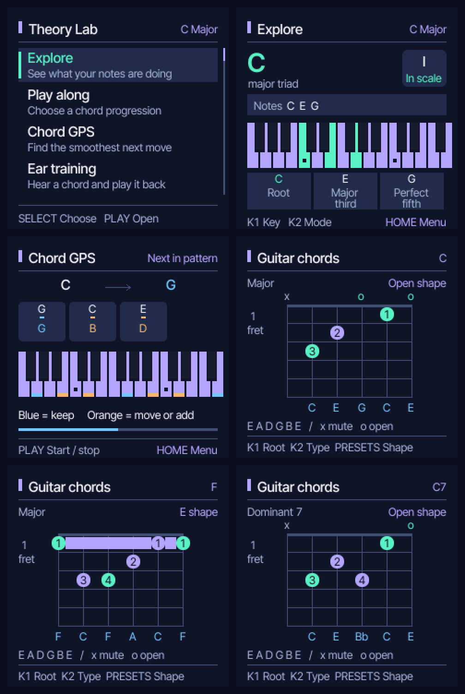

# Theory Lab

[](LICENSE)

Theory Lab turns the **M-VAVE FM-1** into a hands-on music theory companion.
Play notes and chords, explore scales and the circle of fifths, follow a backing
progression, practice with five interactive lessons, and explore guitar chord shapes.

Built on [Felucca](https://github.com/hugelton/Felucca) by Leo Kuroshita and
Hügelton Instruments, with the original attribution and GPL-3.0-only licence.



The interface, lessons and guitar voicings are tested against the real firmware
code in the host simulator. USB installation and startup are also checked on an
FM-1; the screenshots below come from the host simulator.

The FM-1 is the only supported hardware target. This project does not provide, maintain, or accept requests for ports to other devices or software platforms.

## Install

Open the [Theory Lab web installer](https://nheisterkamp.github.io/theory-lab/webapp/installer/)
in Chrome or Edge. Connect the powered-on FM-1 directly with a USB data cable,
close other MIDI apps, click Install and allow MIDI/SysEx access. Keep the cable
connected until the installer reports Done.

To build your own package, use the toolchain described in [BUILDING.md](BUILDING.md):

```sh
./build.sh --release 1.8.1-theorylab2
```

The installable package is `build/felucca-1.8.1-theorylab2.fwsc`. Follow the local
installer instructions in BUILDING.md to load your own package.

The firmware recognizes both the original Puya flash (`0x856014`) and the newer
UC25HQ80 flash (`0xB36014`).

## Theory practice

Theory Lab starts directly in **Explore** with a polyphonic practice sound.
Play to see the note, chord, inversion and each note's function: root, major or
minor third, fifth and seventh. Single notes show their scale degree and interval
above the tonic. Mint marks played notes inside the scale, lavender marks scale
notes, and orange marks played notes outside it. The physical key LEDs guide the
scale and tonic too.

Press **HOME** for the learning menu. Turn SELECT and press PLAY to open an item.
The menu includes Explore, Play along, the five lessons, Guitar chords, Sounds,
Advanced and Device settings. HOME always returns to this menu.

In Explore, KNOB 1 moves through keys by fifths and KNOB 2 changes mode while
keeping the tonic. SCL toggles the circle of fifths. OCT− and OCT+ change the
practice octave. PRESETS changes the practice sound; ENV opens Sounds.

**Play along** offers five ready-made chord loops: I–V–vi–IV, ii7–V7–Imaj7,
i–VI–III–VII, I–IV–V–I and a diatonic cycle. KNOB 1 selects the loop, KNOB 2 sets
the tempo, and PLAY loads and starts it, one chord per bar. The keyboard remains
playable, with the backing chord marked on screen and on the physical key LEDs.
The Chord GPS page opens automatically and shows the next chord, the smoothest
pitch-class moves and a moving progress bar. Practice uses track 1; the generated
loop replaces track 2's pattern and sound. Advanced opens Felucca's synth and
sequencer for custom progressions, effects and projects.

**Sounds** offers Piano, Electric piano, Organ and Soft synth. Choose with PRESETS
and press PLAY to select and hear a short chord.

**Guitar chords** shows standard E–A–D–G–B–E chord diagrams with fret numbers,
finger numbers, barre lines, muted/open strings and note names. KNOB 1 chooses
the root, KNOB 2 chooses major, minor, dominant 7, major 7 or minor 7, and PRESETS
or SELECT cycles open and movable E/A shapes. PLAY auditions the chord on the
FM-1. Playing a supported chord on the FM-1 also selects its guitar shape. The
key LEDs highlight the selected chord tones.

Menu movement animates for 120 ms; backing and riff cursors follow playback.
These animations run in the UI loop without blocking keyboard input.
[Preview the menu animation](docs/menu-motion.gif).

Turn KNOB 4 to browse the five lab pages or return to free play:

- **Chord GPS** shows the next chord programmed on the selected backing track.
  Blue notes can stay, orange notes move or enter, and Lift marks a released
  note. This previews the current pattern, including its wrap.
- **Chord ear** uses PLAY to hear or replay a triad, REC for a new triad, and SCL
  to hide or show the hint. Hold three notes in any inversion to answer.
- **Mode switch** uses REC to capture and finish a monophonic take of up to
  24 notes or 12 seconds. PLAY loops it, KNOB 2 selects the comparison mode,
  and SCL switches between the original and the comparison. Chromatic notes
  keep their original pitch. The take lives in memory for the current session.
- **Chord passport** holds the last played chord and plots its diatonic matches
  on the major and minor rings. KNOB 1 browses them and SCL opens the selected
  key in free play.
- **Landing mission** uses KNOB 1 to choose root, third or fifth, REC to arm
  four chord changes, and SCL to toggle hints. Pick a backing track with
  KNOB 3 and press PLAY. Your first attack within 500 ms of each change counts.

## Project resources

- [Theory Lab web installer](https://nheisterkamp.github.io/theory-lab/webapp/installer/)
- [Web editor](https://hugelton.github.io/Felucca/webapp/editor/) ([source](https://github.com/hugelton/Felucca-WebApp))
- [Manual and release notes](https://github.com/hugelton/Felucca/wiki/Home)
- [Building from source](BUILDING.md)
- [Theory Lab issues](https://github.com/nheisterkamp/theory-lab/issues)

The firmware uses [Felucca-Engines](https://github.com/hugelton/Felucca-Engines) (MIT) for its built-in sound engines and [felucca-bsp](https://github.com/hugelton/felucca-bsp) (MPL-2.0) for the FM-1 hardware layer. Neither repository implies support for Felucca on other hardware.

## Development and support

Felucca focuses on the FM-1. Third-party modifications and ports are independent projects and are not tested or supported here. Contributions are considered at the maintainer's discretion; no development schedule or ongoing support is promised.

Felucca is developed with the assistance of AI coding agents (code, tests, documentation, translation, maintenance). Design, features, sounds and direction are the maintainer's or the community's; no generative AI is used for music, icons or artwork. See [On AI-Assisted Development and Responsibility](https://github.com/hugelton/Felucca/discussions/166).

## Credits and licence

Felucca is free software under [GPL-3.0-only](LICENSE); the Hügelton Sample Pack is CC0 1.0. The engines and hardware layer retain their own licences. See [CREDITS.md](CREDITS.md) and [LICENSING.md](LICENSING.md).

M-VAVE and FM-1 are trademarks of their respective owners. Felucca is not affiliated with, endorsed by or supported by M-VAVE.

Copyright (C) 2026 Leo Kuroshita (@kurogedelic), Hügelton Instruments
