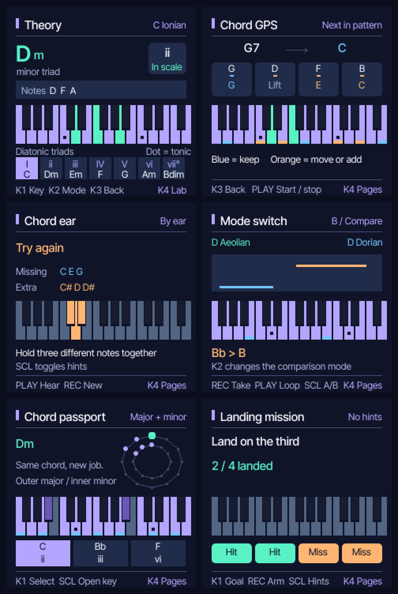

# Chord Compass

[](LICENSE)

Chord Compass turns the **M-VAVE FM-1** into a hands-on music theory companion.
Play notes and chords, explore scales and the circle of fifths, follow a backing
progression, and practice with five interactive lessons.

Built on [Felucca](https://github.com/hugelton/Felucca) by Leo Kuroshita and
Hügelton Instruments, with the original attribution and GPL-3.0-only licence.



The firmware, lessons and update package have been checked in the host simulator.
Physical FM-1 testing is still pending.

The FM-1 is the only supported hardware target. This project does not provide, maintain, or accept requests for ports to other devices or software platforms.

## Install

Build Chord Compass with the toolchain described in [BUILDING.md](BUILDING.md):

```sh
./build.sh --release 1.8.1-theorylab
```

The installable package is `build/felucca-1.8.1-theorylab.fwsc`. Follow the local
installer instructions in BUILDING.md to load your own package.

The base is Felucca 1.8.1. Newer FM-1 units using the UC25HQ80 flash chip require
the compatibility work described in Felucca's [issue #320](https://github.com/hugelton/Felucca/issues/320).

## Theory practice

Hold HOME and tap ARP. Play the keys to see the
notes, chord or interval, and whether the notes fit the selected mode. Purple
marks the scale on screen, mint marks played notes in the scale, and orange
marks played notes outside it. The FM-1 key LEDs also mark the scale and its
tonic.

Turn KNOB 1 to move by fifths and KNOB 2 to change mode while keeping the tonic.
Tap SCL to switch between the live keyboard and the circle of fifths. OCT− and
OCT+ change the practice octave. Tap HOME to exit. Practice uses the selected
polyphonic synth track when available, or the first polyphonic synth track.

For a backing progression, enter chords on a synth track in the sequencer. In
Theory, turn KNOB 3 to select that track and press PLAY. Blue tips on the screen
and fully lit key LEDs mark the current backing chord across the keyboard. The
latest chord stays visible through its gate until the backing track plays new
notes. Theory prefers a separate polyphonic synth for the practice sound when
one is available.

Turn KNOB 4 to browse the five lab pages or return to free play:

- **Chord GPS** shows the next chord programmed on the selected backing track.
  Blue notes can stay, orange notes move or enter, and Lift marks a released
  note. This previews the current pattern, including its wrap.
- **Chord ear** uses PLAY to hear or replay a triad, REC for a new triad, and SCL
  to hide or show the hint. Hold three notes in any inversion to answer.
- **Mode switch** uses REC to capture and finish a monophonic take of up to
  24 notes or 12 seconds. PLAY loops it, KNOB 2 selects the comparison mode,
  and SCL switches between the original and the comparison. Chromatic notes
  keep their original pitch. The take lives in memory for the current session.
- **Chord passport** holds the last played chord and plots its diatonic matches
  on the major and minor rings. KNOB 1 browses them and SCL opens the selected
  key in free play.
- **Landing mission** uses KNOB 1 to choose root, third or fifth, REC to arm
  four chord changes, and SCL to toggle hints. Pick a backing track with
  KNOB 3 and press PLAY. Your first attack within 500 ms of each change counts.

## Project resources

- [Web installer](https://hugelton.github.io/Felucca/)
- [Web editor](https://hugelton.github.io/Felucca/webapp/editor/) ([source](https://github.com/hugelton/Felucca-WebApp))
- [Manual and release notes](https://github.com/hugelton/Felucca/wiki/Home)
- [Building from source](BUILDING.md)
- [Issue tracker](https://github.com/hugelton/Felucca/issues)

The firmware uses [Felucca-Engines](https://github.com/hugelton/Felucca-Engines) (MIT) for its built-in sound engines and [felucca-bsp](https://github.com/hugelton/felucca-bsp) (MPL-2.0) for the FM-1 hardware layer. Neither repository implies support for Felucca on other hardware.

## Development and support

Felucca focuses on the FM-1. Third-party modifications and ports are independent projects and are not tested or supported here. Contributions are considered at the maintainer's discretion; no development schedule or ongoing support is promised.

Felucca is developed with the assistance of AI coding agents (code, tests, documentation, translation, maintenance). Design, features, sounds and direction are the maintainer's or the community's; no generative AI is used for music, icons or artwork. See [On AI-Assisted Development and Responsibility](https://github.com/hugelton/Felucca/discussions/166).

## Credits and licence

Felucca is free software under [GPL-3.0-only](LICENSE); the Hügelton Sample Pack is CC0 1.0. The engines and hardware layer retain their own licences. See [CREDITS.md](CREDITS.md) and [LICENSING.md](LICENSING.md).

M-VAVE and FM-1 are trademarks of their respective owners. Felucca is not affiliated with, endorsed by or supported by M-VAVE.

Copyright (C) 2026 Leo Kuroshita (@kurogedelic), Hügelton Instruments
